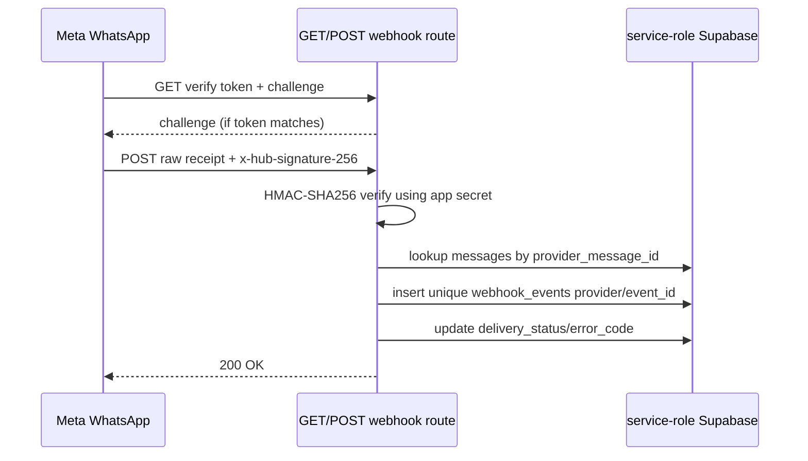

# 05 — Key flows and state transitions

The sequences below reconstruct source behavior, not a live-system trace. Remote credentials, actual database migration state, Meta configuration, and network outcomes are **UNVERIFIED**. [Supabase config](../../supabase/config.toml#L1) · [WhatsApp sender](../../src/api/whatsapp.server.ts#L86-L108)

## 1. Sign up, invited staff, and sign in

```mermaid
sequenceDiagram
  actor User
  participant UI as Login route
  participant Auth as Supabase Auth
  participant Trigger as handle_new_user trigger
  participant DB as Postgres
  User->>UI: Email/password + names/shop, or OAuth
  UI->>Auth: signUp / signInWithPassword / OAuth
  Auth->>Trigger: insert auth.users
  alt matching staff_invites email
    Trigger->>DB: create profile + invited role; delete invite
  else new shop
    Trigger->>DB: create tenant, shop, profile, owner role
    Trigger->>DB: seed pipeline, bays, vendors, DVI template, sample orders
  end
  Auth-->>UI: session (after configured provider/confirmation behavior)
  UI->>DB: load profile, user_roles, shop
  UI-->>User: /board
```

Email/password sign-in, signup metadata, OAuth providers and reset email are wired in the login route. `handle_new_user` assigns invited role based on a matching email; otherwise it creates an owner and shop, then seeds samples. Provider enablement/email confirmation configuration is **UNVERIFIED**. [Login route](../../src/routes/index.tsx#L13-L81) · [signup trigger](../../drizzle/migrations/0001_shopos_business_functions.sql#L56-L82) · [profile load](../../src/lib/auth.tsx#L23-L47)

## 2. Vehicle check-in / repair order creation

```mermaid
sequenceDiagram
  actor Advisor
  participant UI as QuickAddDialog
  participant Fn as quickAddOrder server function
  participant Auth as JWT middleware
  participant DB as Postgres RPC: quick_add_order
  participant WA as WhatsApp sender
  Advisor->>UI: Search/select or enter customer + vehicle + visit
  UI->>UI: validateCheckin + Zod payload
  UI->>Fn: POST authenticated request
  Fn->>Auth: requireSupabaseAuth
  Fn->>DB: quick_add_order(payload)
  DB->>DB: validate tenant ownership; assign CHECKED_IN; allocate RO number; audit
  DB-->>Fn: RO UUID
  Fn->>WA: milestone checked_in (if flag/template permits)
  WA-->>Fn: simulated by default; live send only with WHATSAPP_MODE=live
  Fn-->>UI: order ID/notification result
  UI-->>Advisor: success, navigate to /ro/:orderId
```

Client-side validation covers required customer/vehicle fields, phone, optional email/VIN/odometer/ETA; server input has Zod limits; SQL verifies reused customer/vehicle belong to the caller's shop and creates an audit event. [Validation](../../src/lib/checkin-validation.ts#L1-L26) · [dialog](../../src/components/board/QuickAddDialog.tsx#L108-L151) · [server function](../../src/api/shop.functions.ts#L68-L107) · [SQL RPC](../../drizzle/migrations/0001_shopos_business_functions.sql#L84-L143)

## 3. Repair-order status transition and optional WhatsApp milestone

```mermaid
sequenceDiagram
  actor Staff
  participant UI as TransitionDialog
  participant Fn as transitionOrder server function
  participant DB as transition_order RPC
  participant WA as Mock or Meta provider
  Staff->>UI: Choose target + optional vendor/QC/ETA/tech/bay/notes
  UI->>Fn: orderId + expectedVersion + fields
  Fn->>DB: authenticated RPC
  DB->>DB: lock RO; check shop, version, cooldown, DVI/QC, terminal reopen, technician/bay/vendor
  DB->>DB: update current_status_id/status timestamp/ETA/row_version; write audit event
  DB-->>Fn: version/status/terminal/customer
  opt status maps to enabled milestone
    Fn->>WA: send template if customer opted in
    WA->>WA: Persist simulated by default; Meta API only with WHATSAPP_MODE=live
  end
  Fn-->>UI: result; invalidate board/order; show toast
```

The seed pipeline labels/order are APPT → CHECKED_IN → DVI_INSPECTION → WAITING_PARTS → IN_LABOR → QUALITY_CONTROL → COMPLETED_READY. The transition function enforces business guards, but accepts a target status ID rather than enforcing only the immediately adjacent step; the app permits selecting any listed status. Special guards apply when leaving DVI and entering configured states. [Seeded pipeline](../../drizzle/migrations/0001_shopos_business_functions.sql#L8-L17) · [final guards](../../drizzle/migrations/0004_transition_guards_tech_bay_dvi.sql#L3-L98) · [dialog targets](../../src/components/board/TransitionDialog.tsx#L107-L143) · [WhatsApp state](../../src/api/whatsapp.server.ts#L86-L124)

## 4. DVI send → customer portal approval

```mermaid
sequenceDiagram
  actor Technician
  actor Customer
  participant UI as InspectionPanel / Portal
  participant Fn as sendInspection + portal server functions
  participant DB as Postgres DVI RPCs
  participant Storage as dvi-media
  participant WA as WhatsApp sender
  Technician->>UI: Edit findings, notes, costs, upload/mark up photo
  UI->>DB: dvi_items upsert; Storage upload + dvi_media row
  Technician->>Fn: sendInspection(dviId)
  Fn->>DB: dvi_send
  DB->>DB: require dvi.send; require finding; hash random token; expiry 7 days; set sent; audit
  DB-->>Fn: plaintext one-time token + RO/customer IDs
  Fn->>WA: dvi_ready template with portal token (if opted in)
  Fn-->>UI: portal URL; user may copy/share
  Customer->>Fn: GET portal(token)
  Fn->>DB: portal_resolve(token hash + expiry)
  Fn->>Storage: sign finding-photo URLs for 1 hour
  Fn-->>Customer: shop/vehicle/findings/photos
  Customer->>Fn: decisions + PNG signature + consent
  Fn->>Storage: upload signature PNG
  Fn->>DB: portal_authorize(token, decisions, signature key, IP, UA, consent)
  DB->>DB: lock DVI; update supplied item decisions; authorize; mark RO DVI approved; audit
  Fn-->>Customer: approved total + declined count
```

The token is 32 random bytes, base64url-like encoded, SHA-256 hashed in storage, and expires after seven days. The browser captures a canvas signature; server checks PNG signature bytes and size before upload. Updated source rejects duplicate IDs and migration 0005 requires exactly one decision for each non-green finding; these protections remain pending deployment. [Token creation](../../drizzle/migrations/0001_shopos_business_functions.sql#L297-L318) · [portal reads](../../src/api/portal.functions.ts#L9-L55) · [signature/authorization handler](../../src/api/portal.functions.ts#L58-L120) · [DB decision guard](../../drizzle/migrations/0005_security_limits_and_staff_activation.sql#L66-L86)

The owner-facing inspection panel is refreshed via a Realtime subscription on `dvi_inspections` and React Query invalidation. No email/push notification to the shop after authorization was found; an in-app update is the evidenced path, while other notifications are **UNVERIFIED**. [Realtime](../../src/lib/shop-data.ts#L77-L95) · [publication](../../drizzle/migrations/0000_shopos_core_schema.sql#L377-L379)

## 5. WhatsApp delivery receipt webhook



Receipts are deduplicated by provider/message/status event key; unknown message IDs are ignored. Invalid signatures return 401. The handler returns 200 for malformed JSON after a valid signature. [Webhook](../../src/routes/api/public/webhooks/whatsapp.ts#L6-L73) · [unique key](../../drizzle/migrations/0000_shopos_core_schema.sql#L212-L218)

## State model and guardrails

| State/data | Transition evidence | Notes |
|---|---|---|
| RO `current_status_id` | RPC sets target status and `status_updated_at`, increments `row_version`. | No payment/shipping states or payment tables/flows in the supplied schema. [RO schema](../../drizzle/migrations/0000_shopos_core_schema.sql#L120-L145) · [transition](../../drizzle/migrations/0004_transition_guards_tech_bay_dvi.sql#L80-L98) |
| DVI `not_started → in_progress → sent → approved` | Quick add/start sets in progress; send sets sent; portal authorization sets approved. | `submitted_at` exists and `dvi_submit` SQL exists, but no caller was found in UI/server source; this appears unused. [DVI columns](../../drizzle/migrations/0000_shopos_core_schema.sql#L151-L170) · [submit/send](../../drizzle/migrations/0001_shopos_business_functions.sql#L285-L318) |
| QC `pending → passed` | Optional authorized `p_qc_signoff` sets passed; terminal status may require QC. | UI currently offers QC checkbox for terminal target requiring QC. [Guard](../../drizzle/migrations/0004_transition_guards_tech_bay_dvi.sql#L45-L49) · [UI](../../src/components/board/TransitionDialog.tsx#L64-L70) |
| Message `queued → simulated` or `queued → sent → delivered → read` / `failed` | Sender inserts queued-default row; mock mode updates it to `simulated`; live mode sends externally only when explicitly enabled. | Simulated rows are not deduped against later live sends. [Status constraint](../../drizzle/migrations/0005_security_limits_and_staff_activation.sql#L7-L9) · [sender](../../src/api/whatsapp.server.ts#L84-L112) · [webhook progression](../../src/routes/api/public/webhooks/whatsapp.ts#L5-L6) |

There is no payment lifecycle such as `pending → paid → shipped` in the checked-in application schema or route set; invoice number is only a nullable RO field. **UNVERIFIED:** any external billing or shop accounting platform is not represented here. [RO fields](../../drizzle/migrations/0000_shopos_core_schema.sql#L120-L145) · [route tree](../../src/routeTree.gen.ts#L11-L55)
